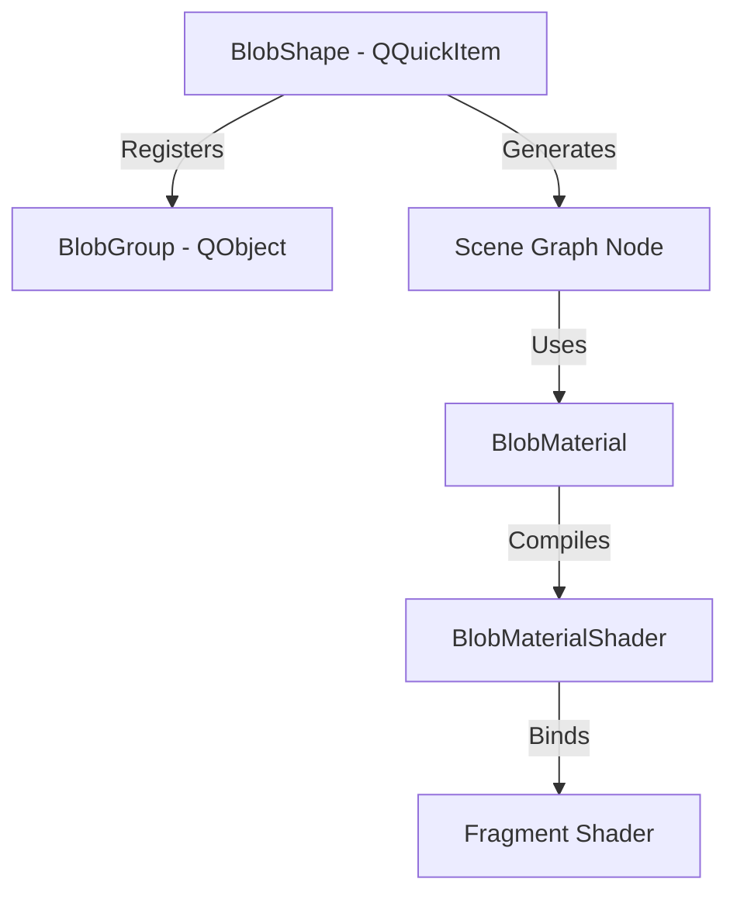

# Caelestia Shell C++ QML Plugin Architecture

Welcome to the documentation for the C++ portion of the Caelestia Shell. This plugin provides low-level system integrations, high-performance UI components, and graphics shaders that are either too slow or impossible to implement in pure QML/JavaScript.

This guide provides an extensive overview of "WTH is going on" inside this library.

---

## Directory Structure

```
plugin/src/Caelestia/
├── Blobs/           # Shader-based fluid morphing geometry (glassmorphic docks/menus)
├── Components/      # Custom high-performance UI components (e.g., virtualizing lists)
├── Config/          # Reactive C++ to QML configuration system
├── Images/          # Image caching and asynchronous providers
├── Internal/        # System indicators, hyprland devices, logind session managers
├── Models/          # Custom models (e.g., FilesystemModel)
├── Services/        # System monitoring (CPU/GPU/Storage) and PipeWire audio analysis
├── appdb.cpp/hpp    # SQLite-backed desktop launcher frequency database
├── cutils.cpp/hpp   # Screenshotting, file, and math utility singletons
├── imageanalyser.*  # Asynchronous dominant color & luminance extractor
├── qalculator.*     # Asynchronous libqalculate wrapper
├── requests.*       # QNetworkAccessManager HTTP GET wrapper
└── toaster.*        # Notification system orchestration
```

---

## 1. The Core Utilities

### `CUtils` (Shell Utilities)
Exposed to QML as a singleton (`CUtils`), this class handles filesystem access and UI rendering to disk.
* **Asynchronous Grab-to-Image:** `saveItem` grabs any QQuickItem and saves it to a file. It uses Qt's Scene Graph `grabToImage()`, connects to its completion, runs the JPEG/PNG compression asynchronously in the thread pool via `QtConcurrent::run()`, and notifies QML via JS callback functions (`onSaved` / `onFailed`).
* **High-DPI Scaling:** Translates screen-space rectangles using `devicePixelRatio()` so that screenshots are clipped accurately on high-DPI displays.

### `Qalculator`
Provides a QML wrapper around `libqalculate` (a powerful multi-functional algebraic calculator).
* **Concurrency:** Evaluation can block for complex equations or currency exchange-rate queries. `Qalculator` runs queries asynchronously in `QtConcurrent::run()`.
* **State Generation:** A generation counter (`m_generation`) tracks concurrent queries to ensure out-of-order evaluations do not overwrite newer user input.
* **Thread Safety:** Access to the global static `Calculator` instance is guarded by a shared mutex `s_calculatorMutex`.

### `AppDb` (Desktop Application DB)
AppDb works with the launcher to monitor and rank application usage frequency.
* **SQLite Backend:** Utilizes an in-memory or disk-backed SQLite database to persist execution counts (`frequencies` table).
* **Fuzzy Matching:** Supports favorite apps filtering. RegEx values are generated and cached using `QRegularExpression::escape()` to dynamically check if desktop entry IDs qualify.
* **Multi-key Sorting:** Sorts applications dynamically based on a custom comparator:
  1. **Favorites first:** Matches RegEx.
  2. **Frequency second:** Sorted descending.
  3. **Alphabetical third:** Handled via locale-aware comparison (`localeAwareCompare`).

### `ImageAnalyser`
Analyzes any image path or active QQuickItem to calculate its visual characteristics in a background thread.
* **Luminance:** Computes relative luminance using the HSP model ($Y = \sqrt{0.299R^2 + 0.587G^2 + 0.114B^2}$) of non-transparent pixels.
* **Dominant Color Extraction:** Quantizes pixel colors by masking the lower 3 bits (`color & 0xF8`), then uses a hash map (`std::unordered_map`) in the worker thread to find the mode (the most frequent quantized bin).
* **Geometry Tracking:** If source is a `QQuickItem`, it tracks dimensions (`widthChanged`, `heightChanged`) and window visibility (`visibleChanged`) before running analysis.

---

## 2. The Blob Rendering System (`Blobs`)

This module manages the fluid, morphing glassmorphic docks/menus that blend into each other. It uses a custom **Scene Graph Material** and **Fragment Shader**.

### Architecture


* **`BlobGroup`:** Container object tracking a list of active `BlobShape` instances, coordinating their properties (colors, blending factors, exclusions).
* **`BlobShape`:** A QQuickItem subclass representing an individual shape element. It computes its screen-space axis-aligned bounding box (AABB) and passes geometry data to the Scene Graph.
* **`BlobMaterial` & `BlobMaterialShader`:** Interacts with the Qt Quick Scene Graph. It packs properties of up to 16 active rectangles (center coordinates, size, deformation matrix, corner radii, and exclusion masks) into a uniform buffer format suitable for uploading to the GPU.

### Mathematical Magic inside `blob.frag`
Rendering fluid shapes on the CPU is slow. The Caelestia blob system does it directly on the GPU using **Signed Distance Fields (SDFs)**:

1. **Inverse Deformation:** `BlobShape` supports rotation and scaling. Instead of transforming vertices, the shader takes the pixel coordinates and multiplies them by the *pre-computed inverse deformation matrix* of each box (`invDeform * (pixel - center)`).
2. **Individual Corner Radii:** Each box's distance field is computed using `sdRoundedBox4`, which evaluates the distance of a point to a rectangle with four independent corner radii (`tr, br, bl, tl`).
3. **Circular Smooth Minimum (`smin`):** To make shapes blend like liquid when they get close, the shader merges distance fields using a circular fillet formula:
   $$smin(a, b, k) = \max(k, \min(a, b)) - \left\| \max(k - a, 0), \max(k - b, 0) \right\|_2$$
   This generates a true circular arc fillet between shapes when both fall within the threshold $k$.
4. **Selective Blending (Exclusion Mask):** Standard metaballs blend everything. The shader uses a bitwise exclusion mask (`excludeMask`). If two shapes are marked to exclude each other, the shader skips the `smin` calculation and performs a sharp `min`, preventing menus from morphing into the dock when they slide open.
5. **Inverted Border Mask (Sink Effect):** To allow shapes to "dock" or merge smoothly into the screen edges, the shader defines an inverted inner border. If a shape moves near the screen boundary, its SDF is scaled dynamically to warp it, creating a "sink" effect.

---

## 3. High-Performance UI Components (`Components`)

### `LazyListView`
QML's default `ListView` can suffer from performance degradation when handling complex delegates or rapid updates. `LazyListView` is a custom virtualizing list.
* **Dynamic Lifecycle:** Instantiates delegates from a `QQmlComponent` only for items that intersect the current `viewport` (expanded by a `cacheBuffer`).
* **Asynchronous Batched Allocation:** Creation and deletion of item delegates are capped to small batches per frame (`ASYNC_BATCH_CREATE = 2`, `ASYNC_BATCH_DESTROY = 4`) to prevent UI micro-stutters during fast scrolling.
* **Height Cache:** Keeps track of item heights (`ItemRecord`). Items can report their height dynamically via the `LazyListViewAttached` properties.
* **Animations:** Triggers smooth entrance (`adding`) and exit (`removing`) states on the attached properties of items, allowing custom QML transition animations.

---

## 4. Audio and System Services (`Services`)

### PipeWire & Aubio Audio Pipeline
Provides the data pipeline for audio visualizers and beat indicators.
```
[System Audio Output]
         │
         ▼
[PipeWire Daemon]
         │
         ▼ (PipeWire Worker Thread)
[AudioCollector] (Double-buffered float array)
         │
    ┌────┴────────────────────────┐
    ▼ (Aubio Thread)              ▼ (CAVA Thread)
[BeatTracker] (Tempo/BPM)    [CavaProvider] (FFT Frequency Bands)
```

1. **`AudioCollector`:** Launches a dedicated real-time worker thread (`PipeWireWorker`) which runs a PipeWire event loop.
   * Connects to the system capture stream.
   * Stores samples at 44100Hz into a double-buffered vector storage (`m_buffer1` / `m_buffer2`).
   * Pointer swapping between buffers is managed atomically to prevent lock contention between the recording thread and processing threads.
2. **`BeatTracker`:** Runs in a separate thread. It extracts PCM data from `AudioCollector` and uses the `aubio` library's tempo detection engine (`aubio_tempo_t`) to emit `beat(bpm)` signals.
3. **`CavaProvider`:** A thread-safe wrapper around `cavacore` (Console-based Audio Visualizer). It pulls PCM chunks, applies windowing/Fast Fourier Transforms (FFT), and groups frequencies into the requested number of equalizer bars.

### System Monitoring Services
These subclasses of `Service` pull hardware telemetry data:
* **`CPU`:** Parses `/proc/stat` to calculate usage percentages.
* **`Memory`:** Parses `/proc/meminfo` to calculate used, free, cache, and swap memory.
* **`DiskInfo` / `Storage`:** Employs `statvfs` to retrieve filesystem storage metrics and monitors mount points by reading `/proc/mounts`.
* **`GPU`:**
  * **NVIDIA:** Loads `libnvidia-ml.so` dynamically using `QLibrary` (NVML) to fetch usage and temperature.
  * **AMD / Intel:** Reads `/sys/class/drm/card0/device/gpu_busy_percent` or hwmon directories in sysfs.

---

## 5. Configuration System (`Config`)

Provides the backing store for user customizations (e.g. fonts, colors, panels).
* **`ConfigObject`:** A serializable property container.
* **`AppearanceConfig`, `BarConfig`, `LauncherConfig`:** Specific configurations mapping system values to C++ types.
* **Dynamic Property Bindings:** Exposes properties to QML and loads/saves them from JSON files in the user path (`~/.config/caelestia`).
